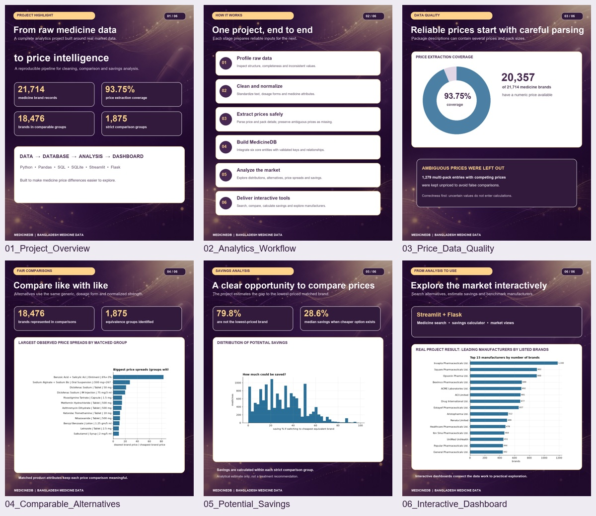

# Medicine Price & Alternatives Intelligence


An end-to-end analytics portfolio project exploring medicine prices, equivalent-label brands,
and potential savings across the Bangladesh pharmaceutical market.



## Quick start

```bash
git clone https://github.com/khalilyasserkhalil068/medicine-price-intelligence.git
cd medicine-price-intelligence
python -m venv .venv
# Windows PowerShell: .venv\Scripts\Activate.ps1
# macOS / Linux: source .venv/bin/activate
python -m pip install -r requirements.txt
python -m streamlit run app.py
```

Run commands from the repository root. The bundled `data/medicine.db` and analysis CSVs
support the dashboards without setting up SQL Server. The SQL scripts target SQL Server
and are a separate part of the analysis workflow.

**Explore:** [Notebooks](notebooks/) · [SQL](sql/) · [Analysis reports](reports/analysis/)
· [Executive report](reports/Assorted_Medicine_Bangladesh_Final_Project_Report.pdf)
· [Deployment guide](DEPLOYMENT_GUIDE.md) · [Contributing](CONTRIBUTING.md)


## Project Overview
This Data Science project processes, cleans, and analyzes the Assorted Medicine Dataset of Bangladesh. The goal is to build a professional, reproducible pipeline that cleans raw medicine datasets and prepares them for an SQL Database, Exploratory Data Analysis (EDA), Alternative Drug Analysis, Patient Savings Calculation, and Interactive Dashboards.

## Dataset
**Name:** Assorted Medicine Dataset of Bangladesh  
Includes **21,714 medicine brands** across 1,711 generics, 240 manufacturers, 113 dosage forms, 421 canonical drug classes, and 2,043 indications.

## Project Pipeline
```text
Raw Data
   ↓
Data Profiling                     → Completed
   ↓
Data Cleaning & Price Extraction   → Completed
   ↓
Code Organization                  → Completed
   ↓
Data Integration & Relational Model→ Completed
   ↓
SQL Database (MedicineDB)          → Completed
   ↓
Exploratory Data Analysis (EDA)    → Completed
   ↓
Alternatives & Price Analysis      → Completed
   ↓
Streamlit Healthcare Dashboard     → Completed 🚀
```

## Key Findings & Insights
* **Price Extraction:** Extracted unit prices for **20,357 medicines (93.75% coverage)**, and pack pricing/sizes for 13,527 medicines, while safely setting ambiguous multi-price formats to `NULL` to guarantee correctness.
* **Alternative Groups:** Formed **1,875 equivalent groups** strictly defined as having the identical `generic_name + dosage_form + normalized strength`.
* **Savings Opportunity:** **79.8%** of medicines are not the cheapest in their group. Switching to the cheapest equivalent brand yields a **median savings of 28.6%** (mean 30.5%).
* **Major Price Discrepancies:** In 23.4% of groups, the most expensive brand costs $\ge 2\times$ the cheapest brand. Over 15.4% of medicines offer savings of $50\%$ or more.
* **Market Concentration:** Top 10 manufacturers hold roughly one-third of all marketed brands.

## Project Structure
```text
project/
├── index.html                         <- Executive Landing Page (Bilingual AR/EN & Interactive Portal)
├── app.py                             <- Streamlit dashboard landing page
├── pages/                             <- Multipage Streamlit application
│   ├── 1_Overview.py                  <- Dynamic KPIs & market-wide distributions
│   ├── 2_Medicine_Alternatives.py     <- Medicine search & equivalent brand ranking
│   ├── 3_Saving_Calculator.py         <- Interactive prescription savings calculator
│   ├── 4_Manufacturer_Analysis.py     <- 107 manufacturers price index benchmarking
│   ├── 5_Therapeutic_Groups.py        <- Therapeutic drug classes & crowded generics
│   └── 6_Data_Explorer.py             <- Interactive dataset browser, quality audit & CSV export
├── utils/                             <- Reusable data modules
│   ├── data_loader.py                 <- Data loading with caching (SQLite & CSV)
│   ├── data_validation.py             <- Input verification & safe savings calculations
│   └── analysis.py                    <- KPI calculations, search & alternative matching
├── data/
│   ├── raw/                           <- Immutable source CSV files
│   ├── cleaned/                       <- Cleaned datasets ready for integration & DB
│   └── medicine.db                    <- Portable SQLite database with analysis views
├── notebooks/
│   ├── 01_data_profiling.ipynb        <- Data profiling & initial quality assessment
│   ├── 02_data_cleaning.ipynb         <- Text normalization, HTML stripping & price regex parsing
│   ├── 03_data_integration.ipynb      <- Entity integrity, cardinality & relational modeling
│   ├── 04_generate_mappings.ipynb     <- Key mapping generation (IDs to names)
│   ├── 05_generate_insert_sql.ipynb   <- Dynamic SQL generation for DB loading
│   ├── 06_eda.ipynb                   <- Exploratory Data Analysis & market distribution
│   └── 07_alternatives_price_analysis.ipynb <- Brand alternatives, price spread & savings analysis
├── sql/                               <- SQL Server DDL, constraint, load & validation scripts
│   ├── 01_create_database.sql
│   ├── 02_create_tables.sql
│   ├── 03_create_constraints.sql
│   ├── 05_validation.sql
│   ├── 06_analysis_queries.sql
│   └── load_medicines_only.sql
├── reports/                           <- Audit reports, cleaning logs, and metrics
│   └── analysis/                      <- Exported analytical CSV tables (alternatives, rankings)
├── run_streamlit.bat                  <- Windows 1-click launcher for the Streamlit app
├── run_dashboard.bat                  <- Windows 1-click launcher for the Flask dashboard
├── run_streamlit.py                   <- Picks a free port, then starts Streamlit
├── run_dashboard.py                   <- Picks a free port, then starts the Flask dashboard
├── requirements.txt                   <- Python dependencies
├── Summery.md                         <- Project context summary and working rules
└── DEPLOYMENT_GUIDE.md                <- How to host each app (Streamlit + Flask)
```

## How to Run the Streamlit Dashboard 🚀

1. **Install dependencies**
   ```bash
   pip install -r requirements.txt
   ```

2. **Launch Streamlit Dashboard**
   Run via Streamlit:
   ```bash
   streamlit run app.py
   ```
   *(Or on Windows, simply double-click `run_streamlit.bat` — it finds a working Python,
   installs anything missing from `requirements.txt`, and starts the app on
   http://localhost:8501)*

3. **Dashboard Pages Overview:**
   * **Home (`app.py`):** Executive summary, methodology disclosure, and quick navigation.
   * **Page 1 - Overview:** Dynamic KPI cards, log/linear price histograms, top manufacturers bar chart, and price dispersion box plots.
   * **Page 2 - Medicine Alternatives:** Real-time search across all 21,714 brands, selected medicine card, and ranked equivalent brands table with savings %.
   * **Page 3 - Savings Calculator:** Prescription calculator supporting custom units, duration presets (15, 30, 60, 90 days), with safe handling of more expensive alternatives and zero-price edge cases.
   * **Page 4 - Manufacturer Analysis:** Portfolios of 107 manufacturers, median price index comparison (budget < 1.0 vs. premium > 1.0), and scatter plots.
   * **Page 5 - Therapeutic Groups:** Drug class exploration, compound brand counts, and market-wide crowded generic tables.
   * **Page 6 - Data Explorer:** Full database browser with multi-filters, column selectors, completeness audits, and CSV export.

## Light and Dark mode

The app is styled from `utils/ui.py`, which reads the theme Streamlit is actually
rendering and emits matching colours. Both modes are fully supported:

```text
⋮  (top-right menu)  →  Settings  →  Theme  →  Light / Dark / System
```

> Note: `.streamlit/config.toml` deliberately contains **no** `[theme]` block.
> Declaring a custom theme there locks the picker above, which prevented Dark
> mode from being enabled.

## Companion Flask dashboard (English, single page)

`dashboard/` holds a second, independent web app: a self-contained Flask
dashboard with no CDN dependencies (Chart.js is vendored in
`dashboard/static/vendor/`), so it also renders correctly offline.

* **Run it:** double-click `run_dashboard.bat`, or run `python run_dashboard.py`.
  It serves on http://localhost:5000 and opens the browser automatically.
* **Ports:** the launchers check the port first. If 5000 (or 8501 for Streamlit)
  is already taken, they start on the next free port and say so, instead of
  crashing with `WinError 10048`. If an **older copy of the dashboard is still
  running** on 5000, the launcher tells you its PID — that old process keeps its
  own pages in memory, so close it to pick up recent changes. Override the first
  choice with the `DASHBOARD_PORT` / `STREAMLIT_PORT` environment variables.
* **Tabs:** Search & alternatives · Savings calculator · Manufacturer benchmark ·
  Therapeutic market.
* **Theme:** a light/dark toggle sits in the page header.
* **API:** `dashboard/app.py` exposes `/api/kpi`, `/api/search`, `/api/medicine/<id>`,
  `/api/alternatives/<id>`, `/api/calculator`, `/api/manufacturers`,
  `/api/top_groups` and `/api/drug_classes`.

**Deployment:** this Flask app and the Streamlit app must be hosted as two
separate deployments — see `DEPLOYMENT_GUIDE.md`.

## Data Assumptions & Methodological Limitations
* **Strict Equivalence Criteria:** Alternatives are matched strictly on identical `Generic Compound + Dosage Form + Strength`. This represents label equivalence, not a clinical bioequivalence certification or pharmacist prescription.
* **No Availability/Stock Data:** The dataset records registered products, not retail pharmacy inventory or real-time shelf availability.
* **Ambiguous Pricing Excluded:** Package descriptions containing multiple distinct package options with conflicting prices are preserved as `NULL` in numerical columns to avoid false assumptions.


## Data provenance and reuse

The source data is identified in the project as **Assorted Medicine Dataset of Bangladesh**
from Kaggle. The original dataset URL, version, and redistribution license are not yet
recorded here. Verify the original publisher's terms before redistributing or reusing the data.
No open-source license is currently granted for this project's original code. Third-party
materials retain their respective terms.

## Author

[Khalil Yasser Khalil](https://github.com/khalilyasserkhalil068)
